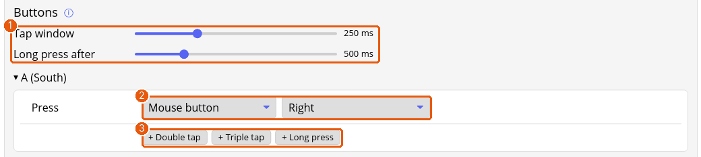

# Tutorial: remapping buttons, gestures and combos

You'll make A click, give B a second job on a long press, and switch a button into a toggle. Open any profile's **Buttons** tab to follow along.

## 1. Change what a button does

Each button has a row. Click its name to open it.

1. The **Tap window** and **Long press after** sliders at the top set the timing for every button in the profile. Leave them for now.
2. The **Press** dropdown is what a plain press does. Choose **Mouse button** and then **Left**: A now clicks.
3. The rows of other buttons stay as they were. A closed row shows a one-line summary of its mapping.

The dropdown offers the gamepad buttons, **Keyboard** (a key, or a combination such as Left Ctrl + C), mouse buttons, the scroll wheel, **Several at once…**, **Toggle on / off…**, **Turbo…**, **Macro…**, **Open menu…**, **Hold layer…**, **Switch mode…** and the overlay actions. *Disabled* does nothing.

## 2. Give the same button a second job

Under the action are **+ Double tap**, **+ Triple tap** and **+ Long press**.

1. Click **+ Long press** on B.
2. Choose what a long press does, for example **Keyboard** and **Esc**.
3. Press **Save & apply** and try it: a quick tap does B's normal action, and holding B for the long-press time does the second.

A button with gestures answers a little later, because Padwight waits to see whether another tap is coming. That's a fair trade for a reload button that also changes ammo on a long press, and a poor one for a jump button.

## 3. Hold it down with Toggle

Games that want you to hold a button to crouch or run are easier with a toggle.

1. Open the button's row and choose **Toggle on / off…** in the **Press** dropdown.
2. Pick the key or button to hold. The first press holds it down; the next press lets go.

**Turbo…** does the opposite job: it presses the action over and over, 2 to 30 times a second, while you hold the button. Wrap a Turbo in a Toggle for auto-fire you can switch on and off.

## 4. Make a combo

A combo is two or more buttons pressed together that act as an input of their own, such as LB + RB.

1. Open the profile's **Combos** tab and press **+ Add combo**.
2. Choose the buttons and the action.

After the first button goes down, Padwight waits a moment (60 ms by default) for the others, so every button that is part of a combo reacts a little later. A button set to *Disabled* works as a modifier with no time limit.

## 5. Save and check

Press **Save & apply**. The picture of your controller at the top of the profile labels each input with what it does. A trailing `+` on a label means the button also does something on a double tap, triple tap or long press.

## Where next

- [Buttons](buttons.md) for the full list, back paddles and gestures.
- [Layers](tutorial-layers.md) change many buttons at once while you hold one.
