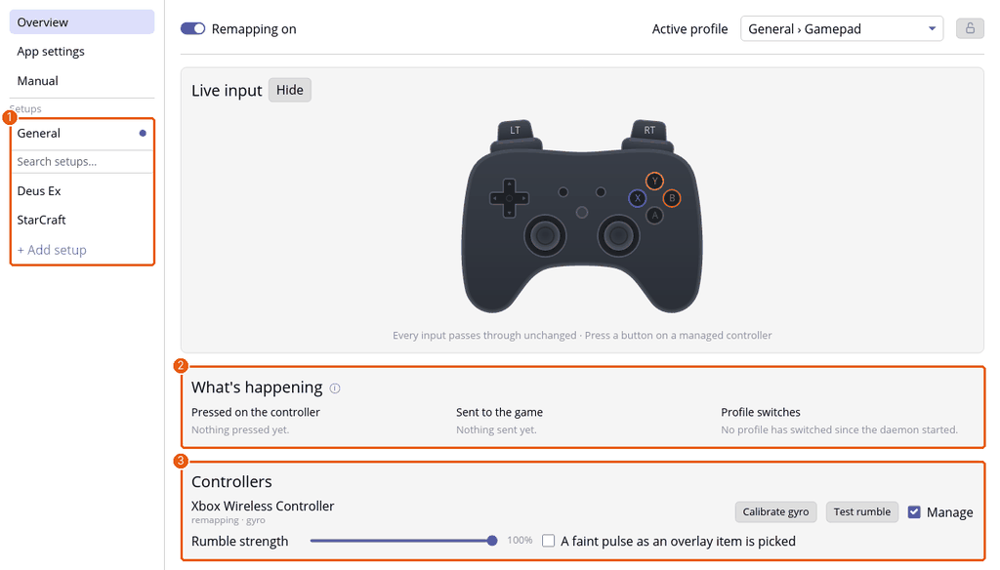
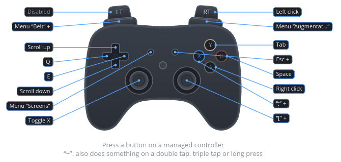
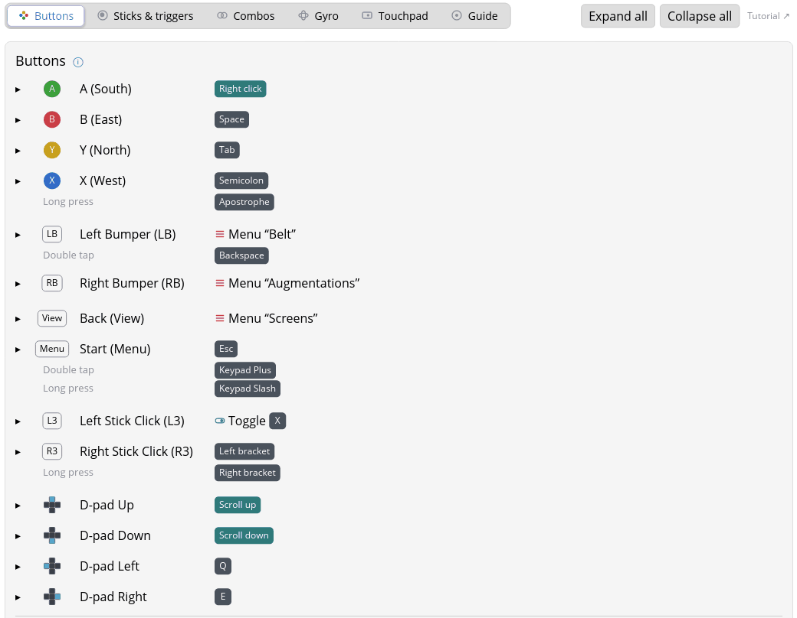
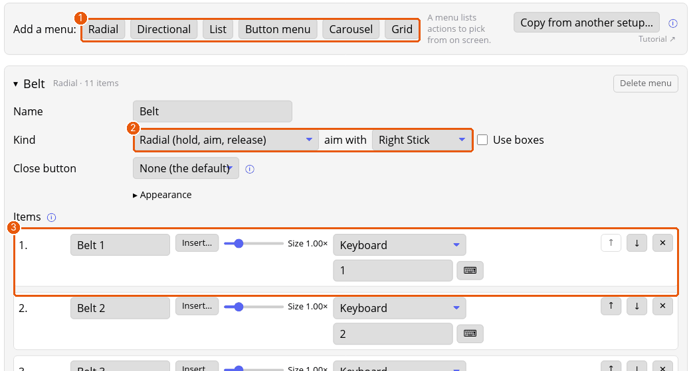
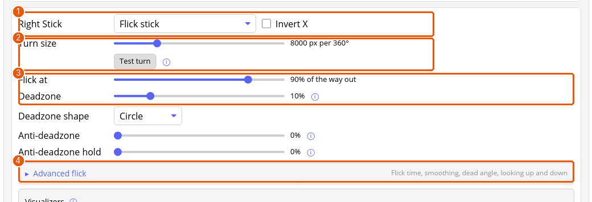

# Tutorial: making a pack, step by step (Deus Ex, Xbox-style pad)

This builds `packs/deus-ex.padpack`, the pack that ships with the app, one input at a time in the settings window, then exports it. Every mapping below is in the finished file. It draws on the other tutorials, which explain each feature from scratch: [buttons](tutorial-buttons.md), [sticks](tutorial-sticks.md), [menus](tutorial-menus.md), [gyro](tutorial-gyro.md), [the Guide button](tutorial-guide.md) and [sharing](tutorial-sharing.md).

The pack targets an Xbox-style pad and the game's default keys, from its `System/DefUser.ini`. Deus Ex has no controller support of its own, so the whole scheme is built here, following the [game setup guidelines](https://github.com/marcinkoza0922/padwight/blob/main/docs/development/game-setup-guidelines.md).

**About the screenshots.** They show the finished pack from the library, so each is the end state of a step. Orange numbers mark the parts a step talks about.

## What you'll end up with

One setup, **Deus Ex**, with three profiles:

| Profile | For | Needs gyro? |
|---|---|---|
| **Deus Ex** | Plain pad, mouse-look on the right stick | No |
| **Deus Ex + Gyro** | The same, plus gyro mouse aiming, paused while LT is held | No (gyro is an extra) |
| **Deus Ex + Flick stick** | Right stick turns the camera in flicks; gyro aims up and down | Yes |

The setup also gets two radial menus (belt and augmentations) and a list of the game's screens. The Guide button needs nothing: its overlay shows the pack's notes and Mapping guide.

## Before you start

1. Make sure the daemon is running: the Overview page (or `padwight status`) lists your controller.
2. Launch Deus Ex once, so the game shows under **Recently focused windows** on the setup's **Details** tab, ready to make the rules.

## Step 1: Create the setup

1. Click **+ Add setup**, open **Empty setup from a template…** and choose **Gamepad pass-through**, to start with no preset mappings.
2. The setup opens on its **Details** tab. Name it **Deus Ex**; that becomes the pack's name.

 holds the templates; the list (3) is the library, where the finished pack comes from.")

The [first setup tutorial](tutorial-first-setup.md) covers the picker and the rules.

## Step 2: Set up the profile

Open the setup's **Profiles** tab.

1. Rename the profile to **Deus Ex** in the **Name** box.
2. Under the Buttons tab's list, keep the default timing: **Tap window 250 ms**, **Long press after 500 ms**.

*Why:* the tap window is how long Padwight waits after a tap for a second one. A shorter window is snappier but makes double taps harder to land. At 500 ms, a normal tap never counts as a long press.

The pack has **no combos** on purpose: a combo makes each of its buttons wait for the others, which delays every press.

## Step 3: Face buttons and the D-pad

On the profile's **Buttons** tab, set each button:

| Button | Action | Game command |
|---|---|---|
| **A** (South) | **Mouse Right** | Use / pick up (`ParseRightClick`). |
| **B** (East) | Keyboard **Space** | Jump. |
| **X** (West) | Keyboard **`;`** (`KEY_SEMICOLON`) | Reload. Gets a long press in Step 7. |
| **Y** (North) | Keyboard **Tab** | Drop / throw (`DropItem`). |
| **Start** | Keyboard **Esc** | Main menu. Gets gestures in Step 7. |
| **D-pad Up** | Mouse wheel **Up** | Previous belt item. |
| **D-pad Down** | Mouse wheel **Down** | Next belt item. |
| **D-pad Left** | Keyboard **Q** | Lean left. |
| **D-pad Right** | Keyboard **E** | Lean right. |

Select gets a menu in Step 4. Guide is the app's own and needs nothing.

**Why these** (from the [game setup guidelines](https://github.com/marcinkoza0922/padwight/blob/main/docs/development/game-setup-guidelines.md)):

- **Use on A, Jump on B.** Deus Ex's Use is the right mouse button, which usually goes on LT, but Use goes on A. With both Use and Jump, Use takes A and Jump takes B.
- **Drop on Y.** A deliberate action that wants its own button, and Y is the one left.
- **Lean on the D-pad's sides, belt cycling on up and down.** Lean is a mirrored pair. The game cycles the belt with the mouse wheel, and scrolling can go on the D-pad.

## Step 4: Menus

The [menus tutorial](tutorial-menus.md) goes through the kinds.

1. **LB → Open menu "Belt"**, **RB → Open menu "Augmentations"**, **Select → Open menu "Screens"** (on the Buttons tab, pick "Open menu…").
2. On the **Menus** tab, add each one:
   - **Belt**: **Radial**, aimed with the **Right Stick**. Items `Belt 1` to `Belt 9` on keys `1` to `9`, `Nanokey ring` on `0`, and `Holster` on **Backspace**.
   - **Augmentations**: **Radial**, aimed with the **Right Stick**. Ten items, `Aug 1 · F3` to `Aug 10 · F12`, on keys `F3` to `F12`.
   - **Screens**: **List**. `Inventory` on **F1** and `Goals and notes` on **F2**.

**Why this design:**

- **Radials on the bumpers for the number and function keys.** The game uses 0 to 9 for the belt and F3 to F12 for augmentations: one item per hotkey. Hold the bumper, aim with the right stick, let go to pick.
- **Holster on the belt too.** Holstering belongs on the input that took the item out (Step 7 explains the double tap), and the item makes it easy to find.
- **Slot 0 is named.** The nanokey ring always sits in belt slot 0. The other slots change with what you carry.
- **A list on Select for the game's screens.** Tap Select, move with the D-pad and press A to open the inventory or goals. The list has a close button, so it stays up after the tap; Select or B closes it. The other screens are tabs inside the inventory, with no keys of their own.

## Step 5: The sticks

The [sticks tutorial](tutorial-sticks.md) explains each control.

### Left stick: walking and running

For the **left stick**:

- Action: **Button ring** with **8** sectors. Press **WASD** next to *Fill with*: up is **W**, down **S**, left **A**, right **D**, and the diagonals press two keys at once.
- **Deadzone** 12%, **Starts at** 25% of the way out, **Stickiness** 10% of a sector.
- Add a **zone** from **0.00 to 0.60** with action **Keys** and **Left Shift**.

, and below it the right stick's mouse settings (3, 4).")

The zone is the walk/run split: the game's Shift is `Walking`, so a light push walks and a full push runs.

**Starts at 25%** makes the keys press early in the stick's travel, so movement starts quickly.

### Right stick: mouse look

For the **right stick**: **Mouse pointer**, **Speed** **2600** px/s, **Deadzone** 12%, and under **Response**, **Custom** with **Curve** **2.20**, **Acceleration** 50% with a **Ramp time** of **350 ms**. Open **Advanced** and set **Vertical speed** to **0.75**.

It's shaped like a console shooter's look, as the guidelines ask:

- **Curve 2.2** keeps small pushes slow for fine aim, with full speed at full push.
- **Acceleration** speeds the turn up by half again over 350 ms when the stick is held all the way over.
- **Vertical at 0.75** of the horizontal speed.
- **2600 px/s** turns about 120° a second at the game's default mouse sensitivity. Adjust to taste.

On the game's screens the right stick moves the cursor, with RT and A as the clicks.

### Stick clicks

- **Left stick click (L3)**: **Toggle on / off…** with keyboard **X** (`Duck`). Crouch is a hold in the game; the toggle makes one click crouch and the next stand.
- **Right stick click (R3)**: keyboard **`[`** (`ToggleScope`). Its long press, in Step 7, is the laser sight.

**Why the scope is on R3:** zoom goes on R3 or D-pad Up. The game toggles the scope itself, so the button is a plain key. The laser sight, a related aid, shares the button as a long press.

## Step 6: The triggers

On the **Sticks & triggers** tab, set both triggers to work as a button with a **threshold** of 0.30:

- **Right trigger (RT)**: **Mouse click** **Left** (fire).
- **Left trigger (LT)**: **Gyro inactive while held**.

Deus Ex has no secondary fire, and its right mouse button is Use, which went on A. That leaves LT for the gyro clutch. It does nothing in this profile, which has no gyro, but the gyro profiles copied from it in Steps 11 and 12 keep it.

## Step 7: Gestures (one button, several jobs)

Open the button's row and press **+ Double tap**, **+ Triple tap** or **+ Long press** under its action, then choose the gesture's action.

 sit under a button's action.")

| Button | Gesture | Action | Mapping guide text |
|---|---|---|---|
| **X** | Long press | Keyboard `'` (`SwitchAmmo`) | "Change ammo" |
| **R3** | Long press | Keyboard `]` (`ToggleLaser`) | "Laser sight" |
| **LB** | Double tap | Keyboard **Backspace** (`PutInHand`) | "Holster" |
| **Start** | Double tap | Keyboard **Keypad Plus** (`QuickSave`) | "Quick save" |
| **Start** | Long press | Keyboard **Keypad Slash** (`QuickLoad`) | "Quick load" |

**Why these:**

- **Change ammo on a long press of Reload.** Reload is the tap, changing ammo the hold.
- **Holster on a double tap of LB.** Holster goes on a long press of the button that took the item out, but a long press would break LB's held menu, so it's a double tap, plus a Holster item in the belt.
- **Start: save on double tap, load on long press.** Loading throws away progress, so it takes the more deliberate gesture.

> **Latency cost.** A button with a gesture waits to see which it is: up to the tap window (250 ms) for a double tap, or until release for a long press. Reload, the scope and Start fire on release, and the belt menu opens after the tap window.

## Step 8: The Guide button, the Mapping guide and the notes

The Guide button needs nothing: it works the same in every game (see [the Guide tutorial](tutorial-guide.md)).

On the profile's **Guide** tab, the **Mapping guide** gives each input the words the overlay shows. The Lean and belt-cycling rows each merge both D-pad sides, with **Share with**.

 and the Mapping guide (2).")

The **notes** on the same tab say what a player wouldn't guess:

- Start (Escape) backs out of every in-game screen. Without this, a player trying B to go back would be stuck.
- On those screens the right stick is the cursor, RT a left click and A a right click.
- Tap Select for the list of the inventory and goals screens; Select or B closes it.
- Keypads take Guide + Y (numpad), computer logins Guide + X (keyboard).
- A light push of the left stick walks, a full push runs.
- The scope is a toggle, slot 0 is the nanokey ring (double tap LB, or pick Holster on the belt, to put the item away), and the augmentation slots follow the order you installed them.

## Step 9: Look and sound

Overlays should look and sound like the game. On the **Details** tab, the pack gives its menus, keyboard, numpad, media controls and in-game menu the Rajdhani font and a dark steel-blue palette with square corners and thin bracket frames, like the game's menus. Its menus click and beep like the game's computers, and overlays snap in and out (`brutal` motion) like the game's windows.

## Step 10: Check every input in the game

1. Press each button with **Live input** shown on the Profiles tab, and check it shows the right action.
2. Walk and run: a light push walks, a full push runs.
3. Aim: the right stick should feel like a console shooter, and speed up when held all the way over.
4. Fire and scope: RT fires, R3 raises and lowers the scope, holding R3 toggles the laser.
5. Menus: hold LB and RB, aim, and release. Tap Select and pick Inventory with A; tap Select again and close the list with B.
6. Gestures: double tap LB, double tap Start, long press Start, and long press X.
7. Screens: open a keypad, use Guide + Y, and back out with Start.

If something doesn't work, check the rule, then that the profile is active (the top bar shows it), then the mapping.

## Step 11: The gyro profile: "Deus Ex + Gyro"

Shooters get gyro and flick stick profiles to try, but never as the default: the rules start on the plain profile.

1. On the **Profiles** tab, duplicate the **Deus Ex** profile, and rename the copy to **Deus Ex + Gyro**.
2. On its **Gyro** tab:
   - **Gyro**: **Mouse (gyro aiming)**, **Sensitivity** **30** (pixels per degree turned).
   - **Turning read as**: **Player space (any grip)** (turning left aims left however you hold the controller).
   - Under **Advanced**, **Ignore jitter below**: 1.0 °/s.
3. Leave **Profile requires gyro** unticked.

**Why:** gyro adds fine aim on top of the right stick, so the profile plays without it. LT, the clutch from Step 6, turns gyro off while held, to reposition the controller.

## Step 12: The flick stick profile: "Deus Ex + Flick stick"

A flick stick turns the camera by flicking the right stick instead of holding it over. It only turns left and right, so looking up and down needs gyro, which this profile **requires**.

1. Duplicate the **Deus Ex + Gyro** profile, and rename the copy to **Deus Ex + Flick stick**.
2. On its **Sticks & triggers** tab, set the **right stick** to **Flick stick**: **Turn size** **8000** px per 360°, **Flick at** 90% of the way out, **Deadzone** 10%. Under **Advanced flick**, set the flick time to **100 ms**, smoothing to **0 ms**, the dead angle to **0°** and looking up and down to off. Use **Test turn** to check that 8000 px turns a full circle in the game.

3. On its **Gyro** tab: sensitivity **22.0**, about one to one with that turn size.
4. Tick **Profile requires gyro**.

> **Calibration.** Turn size depends on the game's mouse sensitivity: set it again with Test turn if you change that.

## Step 13: Describe the pack and export it

1. Open the setup's **Details** tab and check the rules, then press **Export…** in the **Pack** card.
2. The **Export** window lists what's in the pack (3 profiles, 3 menus), what the profiles need (the flick profile needs gyro), and any broken references. Fix those, then fill in:
   - **Version**: `1.0` for a first release (the library pack is at `1.2`). Bump it for each release; a higher version marks installed copies *update*.
   - **Author**: your name.
   - **Made with**: "Xbox controller".
   - **Description**: what the pack does and how it's laid out. The pack's own description is: "The original Deus Ex (2000) on an Xbox-style pad, for the game's default keys. A uses, B jumps, RT fires…"

.")

3. Press **Save…** and save as `deus-ex.padpack`.
4. Press **Save & apply** to keep the export details in the setup.

The [sharing tutorial](tutorial-sharing.md) covers this window and importing.

### Test the export by importing it

1. In the sidebar, click **+ Add setup**, then **Import a file…**, and choose the file.
2. The preview shows the contents, what your controller lacks (on a plain pad, the flick profile isn't offered), and the clash with your own Deus Ex setup. Use **Rename**, then delete the copy after testing.

## Step 14 (maintainers): add it to the library

The library is the set of packs that ship with the app, in `packs/`.

1. In a debug build, tick **Release it as the built-in …** on export, so the setup keeps its library ID and installed copies get it as an update.
2. Copy the file into `packs/` and run the tests. They check the format, IDs, names and references, that each rule points at a profile, and that one profile works on a plain pad.
3. Rebuild: the build embeds every pack in `packs/`. See the [architecture notes](https://github.com/marcinkoza0922/padwight/blob/main/docs/development/architecture.md).

## Summary: the less obvious choices

| Choice | Guideline |
|---|---|
| Use (right mouse) on A, Jump on B | Right mouse goes on LT unless it's Use; with Use and Jump, Use takes A. |
| Gyro clutch on LT | No secondary fire, and right mouse is Use, so LT is free. |
| Scope on R3, laser on its long press | Zoom goes on R3 or D-pad Up; related actions share a button. |
| Crouch toggle on L3 | Crouch is a toggle, on L3 (B is taken by Jump). |
| Walk on a 60% Shift zone | Walk is a left-stick zone over the first 50 to 70%. |
| Lean on D-pad left/right, belt cycling on up/down | Mirrored actions and scrolling go on the D-pad. |
| Change ammo on a long press of Reload | They share a button. |
| Radials on LB and RB | Number and function key hotkeys go on radial menus on the shoulders, every hotkey an item. |
| Holster on a double tap of LB, and in the belt | Holster goes on the input that took the item out; a long press would break the held menu. |
| Inventory and goals in a list on Select | Separate screen keys go in a list on Select; a list with a close button stays up when Select is let go. |
| Start: Esc, double tap save, long press load | The system buttons. |
| Notes on backing out with Start | Notes say what a player wouldn't guess. |
| Console-like right stick | Shooters get a radial deadzone, a power curve and console-ish speed. |
| Gyro and flick stick profiles, never the default | Always offered for shooters; the rules start on the plain profile. |

## Troubleshooting

- **The rule doesn't switch to the profile.** Check the executable name (for Proton games, the Windows `.exe`, `DeusEx.exe`) and the Steam App ID against **Recently focused windows** on the Details tab.
- **The game sees two controllers.** A PlayStation or Switch controller can reach the game directly too. Set `SDL_JOYSTICK_HIDAPI=0` (see [Troubleshooting](troubleshooting.md)).
- **A button feels late.** It has a gesture, so it waits for the tap window. See the latency note in Step 7.
- **Guide's shortcuts don't work.** Hold Guide and press the shortcut, or tap Guide to open the overlay and then press it. See [The Guide button](guide-button.md).
- **A row in the Mapping guide reads wrong.** Fix the text on the profile's **Guide** tab.
- **The flick profile is missing.** It needs gyro, so with a plain pad it isn't offered. The import preview lists profiles it won't offer.
