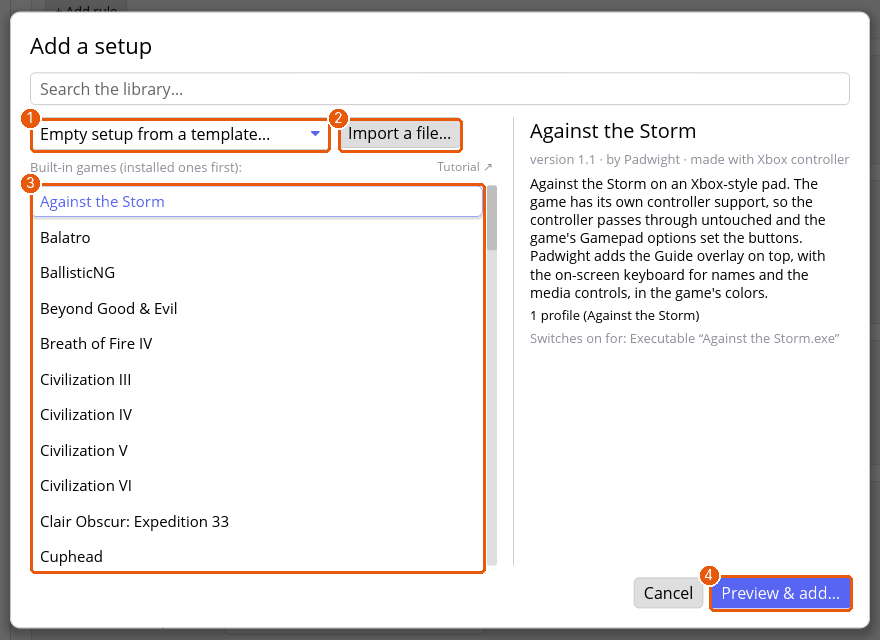
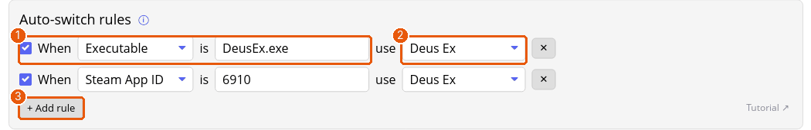

# Tutorial: your first setup for a game

This walks through giving one game its own controls: you add a setup, tell Padwight which window is the game, and change a button. It takes about five minutes. The Deus Ex pictures in this manual come from a setup added the same way.

**You'll need:** the daemon running (the top bar says so, and the Overview lists your controller), and the game installed.

## 1. Add the setup

1. Click **+ Add setup** at the bottom of the sidebar.
2. Pick where to start from:

   1. **Empty setup from a template…** starts from a ready-made profile. Choose this when the game isn't in the library.
   2. **Import a file…** adds a `.padpack` someone sent you. See [the sharing tutorial](tutorial-sharing.md).
   3. The **library** lists the setups that ship with Padwight. Click one to read its description.
   4. **Preview & add…** shows what the setup holds before anything changes.

If the game is in the library, add it, press **Save & apply**, and you're done: the setup comes with its rules and profiles. The rest of this tutorial is for a setup you start empty.

An empty setup opens on its **Details** tab, named *New setup*. Rename it to the game's name in the **Name** box.

## 2. Tell Padwight which window is the game

Padwight switches to a setup when its window has focus. On the **Details** tab, **Auto-switch rules** says which window that is.

1. **+ Add rule** adds a row. In the row:
   1. The first box says what to match: the program's name (**Executable**), its **Steam App ID**, or its window class. Wine and Proton games match by their `.exe` name, like `DeusEx.exe`.
   2. The last box picks the profile the setup switches to.
2. Don't know the name? Start the game, focus it, and look under the rules for **Recently focused windows**. Its **+ Rule** buttons make the row for you, for the profile you're editing.

> **Tip:** automatic switching needs a desktop that reports which window has focus. See [Troubleshooting](troubleshooting.md).

## 3. Check for native controller support

Many games already support a DualShock, DualSense or Switch Pro Controller on their own. If this one does, tell Padwight, so the game sees your controller as the kind it knows and its own scheme works with it.

1. Look for controller support in the game's options, its controls or gamepad menu, the store page, or the game's own documentation or community wiki. Count only explicit support: a store badge alone isn't enough, and a game released before 2006 doesn't count, since its controller support is unreliable.
2. On the **Details** tab, scroll to **Controllers this setup supports**. Tick **DualShock 4**, **DualSense** or **Switch Pro Controller** for each kind the game supports, and leave the others unticked.
3. The ticks apply while this setup is active. A controller of a ticked kind is then seen by the game as that kind, with its own button names and glyphs, and you only need to change the bindings the game doesn't cover.

> **Tip:** an Xbox controller, or a kind the game doesn't list, is seen as an Xbox 360 pad, as before.

## 4. Change a button

1. Open the setup's **Profiles** tab. Rename the profile if you like.
2. Click a button's name, say **A (South)**, to open its row. Pick what it does from the first dropdown: a key, a mouse button, the scroll wheel, a macro and so on. The [Buttons tutorial](tutorial-buttons.md) goes through the options.
3. Not sure which row is which button? Press **Find by pressing**, then press the button on your controller.

## 5. Save and try it

1. Press **Save & apply** at the bottom. It lights up only while something has changed, and the change starts working straight away.
2. Switch to the game. The top bar's **Active profile** changes to the setup's profile when the window gets focus, and the **Overview** page shows the switch in **What's happening**.
3. If it doesn't switch, check the rule's value against **Recently focused windows**, then see [Troubleshooting](troubleshooting.md).

You can always pick a profile by hand from **Active profile** in the top bar.

## Where next

- [Buttons](tutorial-buttons.md), [sticks](tutorial-sticks.md) and [gyro](tutorial-gyro.md) for the controls themselves.
- [Controller setups and profiles](setups.md) for how setups, profiles and rules fit together.
