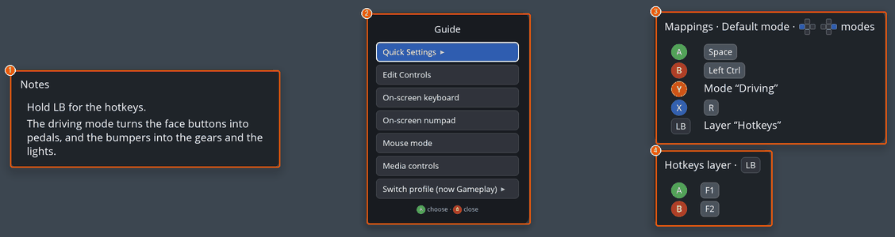
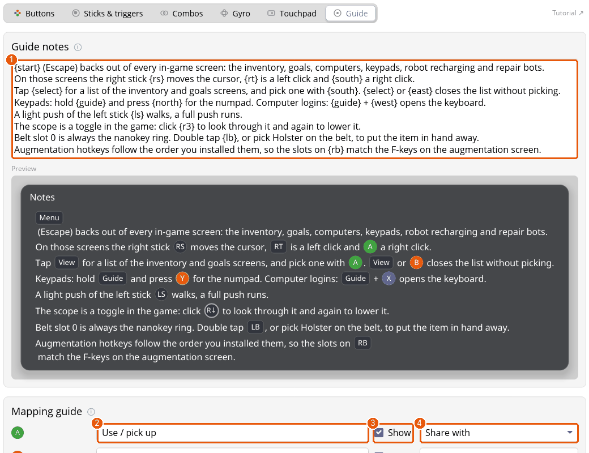
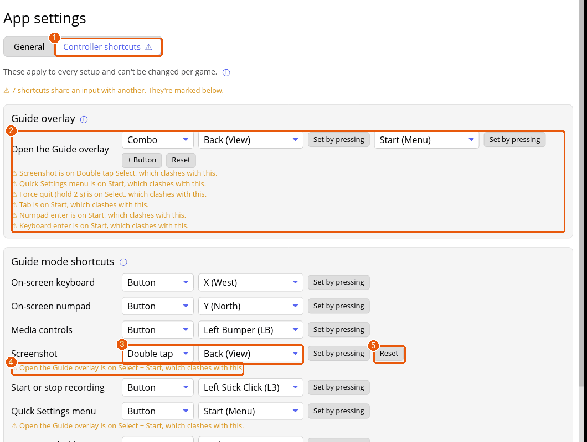
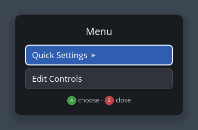

# Tutorial: the Guide button, the Mapping guide and the in-game menu

The Guide button (the Xbox, PlayStation or Home button) works the same in every game, and Padwight keeps it from the game and from Steam. You'll use the Guide overlay, write the notes and mapping guide a profile shows in it, and change settings while you play.

## 1. Open the Guide overlay

Tap Guide in a game. The overlay opens when you let go, and a second tap closes it.

1. **Notes** (1): what the author of the setup wants you to know.
2. **The menu** (2): Quick Settings, Edit Controls, the on-screen keyboard and numpad, mouse mode, media controls, Switch Profile (to pick another profile of the game, or make a new one) and, while Steam runs, the Steam overlay. Move with the D-pad or Left Stick, choose with A, close with B.
3. **Mappings** (3): what each button, trigger and stick does in the current profile and mode. When the setup has [modes](tutorial-modes.md), press Left or Right to look at the others.
4. **A layer's section** (4): each [layer](tutorial-layers.md) a button holds gets its own box below.

**Shortcuts:** hold Guide and press X for the on-screen keyboard, Y for the numpad, LB for media controls, RB for a screenshot, L3 to start or stop a recording, or hold Select for two seconds to force-quit the focused window. With the overlay open you can press the shortcut alone. Hold Guide and press the Right Stick for **mouse mode**, where the controller drives the pointer; press Guide to leave it.

No Guide button on your controller, or a shortcut in the way? Open **App settings › Controller shortcuts** to move what opens the overlay (to Start + Select, say) and any of these shortcuts. See [moving the shortcuts](guide-button.md).

## 2. Write the notes and the mapping guide

Both belong to a profile. Open its **Guide** tab.

1. **Guide notes** (1) is plain text. Write what the controls don't make obvious: where to find a hidden command, when to switch layers. `{buttons}` in curly braces show as glyphs, like info overlays do, and the preview under the box shows them drawn.
2. The **Mapping guide** lists a row for each input. Its text (2) is what the overlay's Mappings box says. Change it to plain words: "Use / pick up" reads better than "Mouse right click". An empty box keeps the default text, shown as the placeholder.
3. Untick **Show** (3) to hide a row from the overlay. The mapping still works.
4. **Share with** (4) merges inputs into one row, such as both D-pad sides for "Lean". **Split** undoes it.
5. **+ Add a row** at the bottom writes a row of your own, for things the mappings don't show, such as what a layer's chord does.

Press **Save & apply**, then tap Guide in the game to see it.

## 3. Move the shortcuts

Every shortcut above can be moved, which helps a controller with no Guide button. Open **App settings** and pick the **Controller shortcuts** tab. What you set here applies to every setup.

1. The tab shows a ⚠ (1) while something needs a look.
2. **Open the Guide overlay** (2) is Guide unless you move it. Pick **Button**, **Double tap**, **Triple tap**, **Long press** or **Combo**, then choose the button, or press **Set by pressing** and press it on the controller. A combo takes up to four buttons (**+ Button**). Setting it to **Off** is allowed, with a warning, because then nothing opens the overlay. If a profile of one of your setups already uses that input, the row lists it, and a ⚠ shows beside that setup in the sidebar.
3. Each shortcut of the Guide mode and each key of mouse mode has the same choices (3). Choose **Off** to switch one off, with no warning.
4. A ⚠ line (4) says which other shortcut shares the input. Both still save, but only one can work.
5. **Reset** (5) puts a shortcut back where it started.
6. At the bottom, **Menu buttons** moves the buttons that choose and go back in menus and panels, for example to swap A and B.

The Guide button itself stays reserved: nothing else can be put on it.

## 4. Change controls while you play

Hold Guide and press Start (or choose it from the Guide menu) to open the in-game menu over the game.

**Quick Settings** changes stick speeds, gyro sensitivity, Invert Y, dead zones, rumble strength, overlay size and the profile, and has a switch that turns remapping off if a mapping gets in the way. Left and right change a number by about 10%, or by half with RB held. A number you changed shows what it was when you opened the menu.

**Edit Controls** opens the full editor for the game in front of you: buttons, sticks, gyro, combos, modes, layers, macros, menus and info overlays. Changes apply straight away, and are written to the config file only when you save. If you leave with unsaved changes, A saves, X discards and B keeps editing.

If a window is in front but no setup matches it, the first change creates a setup for that window, named after the program, so you can fix a game's controls without leaving it.

## Where next

- [The Guide button](guide-button.md) and [Changing controls while you play](in-game-menu.md) for the reference.
- [Your first setup](tutorial-first-setup.md) if the game has no setup yet.
