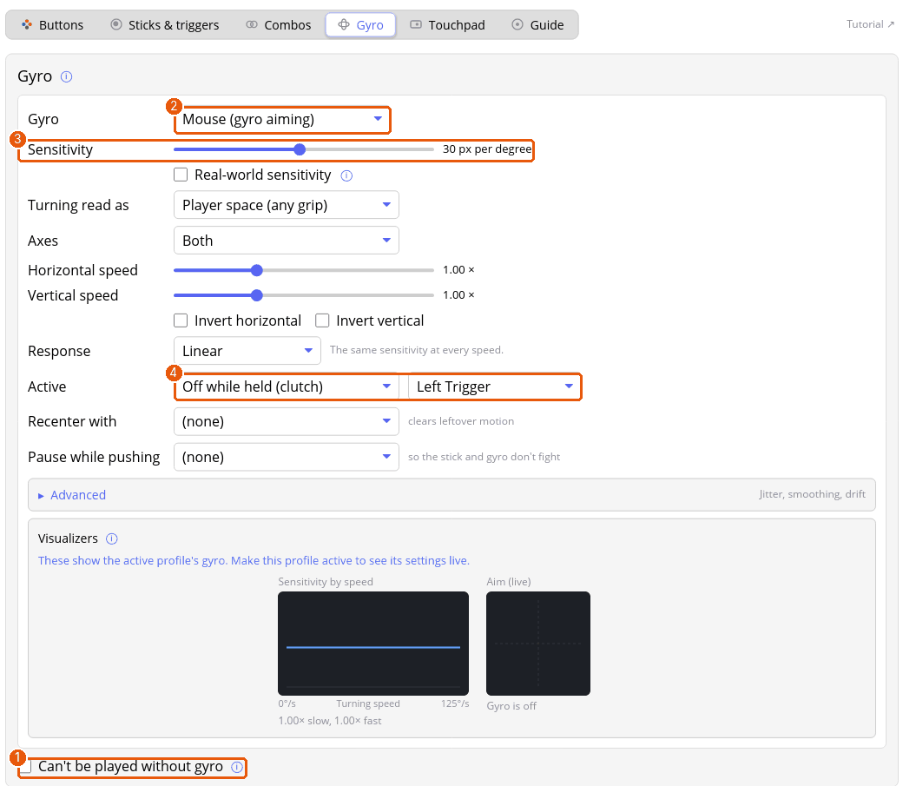

# Tutorial: aim with the gyro

On a DualShock 4, DualSense, Switch Pro controller or Joy-Con you can aim by turning the controller. You'll set up gyro as mouse aiming, with a button that switches it off while you reposition your hands.

**You'll need** a controller with gyro, and on PlayStation and Switch controllers the motion-sensor permission rule from [Troubleshooting](troubleshooting.md). Without it the Overview says the daemon can't open the sensors.

## 1. Calibrate

Keep the controller still on a table, then press **Calibrate gyro** next to it in the controller list on the **Overview** page. It takes two seconds and sets the baseline that small drift is measured from.

## 2. Make a profile for it

Gyro belongs to a profile. A good habit is to keep your plain profile and make a copy for gyro: on the **Profiles** tab press **Duplicate**, and rename the copy, for example *Play + Gyro*. Then open its **Gyro** tab.

## 3. Turn it on

1. Choose **Mouse (gyro aiming)** in the first dropdown (2). The other modes push a virtual stick instead, or steer like a wheel.
2. **Sensitivity** (3) is how many pixels the pointer moves for each degree you turn. Start at 30. Tick **Real-world sensitivity** if you'd rather enter the game's full turn: then every game feels the same for the same setting.
3. **Turning read as** should be **Player space** for most people: turning left aims left however you hold the controller, flat or upright.
4. **Axes** lets gyro do both directions, or only up and down, which suits a profile where the stick turns and gyro adjusts the aim.
5. **Horizontal speed** and **Vertical speed** scale each direction.

## 4. Choose when it works

Open **Active** (4). **Always on** is the simplest. For a clutch, pick **Off while held** and a button, as in the picture: hold Left Trigger to lift the controller and bring it back without the view turning. **Only while held** works the other way: gyro only while you hold the aim button. A toggle can give a short rumble when it switches.

**Pause while pushing** turns gyro off while you push a stick, so the stick and gyro don't fight.

## 5. Tune the feel

- **Response** changes sensitivity with how fast you turn. *Precision* is slow for small movements, for sniping; *Turn boost* leaves aiming alone and speeds up big quick turns.
- Under **Advanced**, **Smooth below** steadies slow, careful aiming without delaying fast turns, and **Re-measure drift whenever the controller is set down still** keeps the baseline right as the controller warms up.
- The **Visualizers** at the bottom draw the curve with your current turning speed on it. They show the active profile's saved settings, so make the profile active and press **Save & apply** to watch them move.

## 6. Say if the profile needs gyro

Tick **Can't be played without gyro** (1) only if the profile depends on it, such as a flick-stick profile that turns left and right with the stick and up and down with gyro. Players whose controller has no gyro then aren't offered it when they import your pack. Leave it unticked when gyro is an extra.

## Where next

- [Gyro](gyro.md) for every setting.
- [Changing controls while you play](in-game-menu.md): Quick Settings changes gyro sensitivity or turns gyro on and off without leaving the game.
