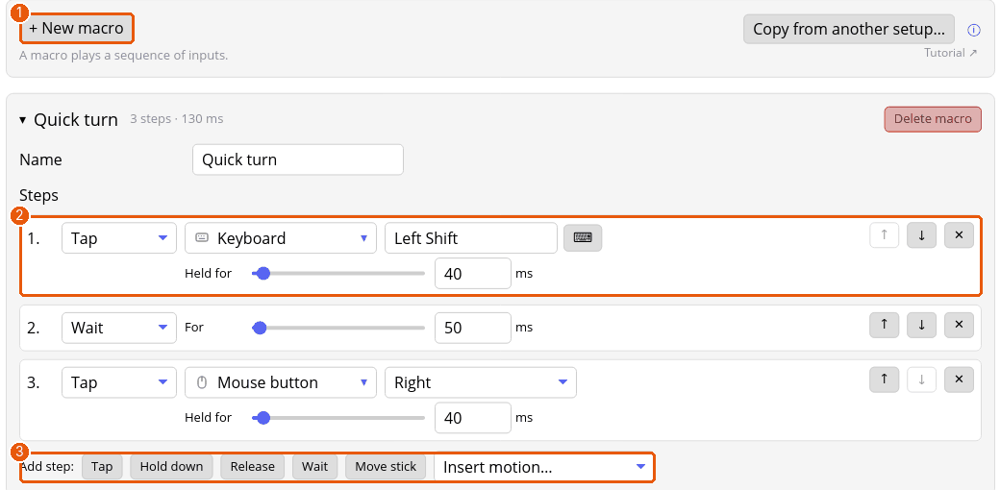

# Tutorial: record a sequence into a macro

A macro is a saved sequence of presses, holds, releases and waits that plays back when you press one button. You'll make a *Quick turn* macro and put it on a button.

## 1. Make the macro

1. Open the setup's **Macros** tab and press **+ New macro** (1). The new macro opens at the top, ready to name.
2. Type its name in the **Name** box: *Quick turn*.
3. Add steps with the buttons under the list (3):
   - **Tap** presses and lets go after a time you set (**held for**, in milliseconds).
   - **Hold down** presses and keeps holding, until a **Release** of the same input or the end of the macro.
   - **Release** lets go of something held.
   - **Wait** pauses for a number of milliseconds.
   - **Move stick** puts a virtual stick somewhere until another step moves it.
   - **Insert motion…** adds a quarter circle, dragon punch or half circle for fighting games, one frame apart, written for a character facing right.
4. Each step's action button and dropdown choose the input: a key or combination, a mouse button, the scroll wheel or a gamepad button. In the picture (2), step 1 taps **Left Shift** for 40 ms, step 2 waits 50 ms, and step 3 taps the right mouse button.
5. The arrows beside a step move it up or down, and **×** removes it. The line at the end shows how long the macro plays.

## 2. Put it on a button

1. On a profile's **Buttons** tab, open the button you want, say **RB**.
2. Click its **Press** button and choose **Macro**, then pick *Quick turn*.
3. Choose how it plays:
   - **Play once** (the default): each press plays the whole macro, even if you let go early.
   - **Repeat while held** loops it while you hold the button and stops straight away when you let go.

Anything a pass of the macro still holds is let go when the pass ends. To loop a macro without holding the button, wrap its action in **Toggle on / off…** and choose the macro inside it.

## 3. Save and try it

Press **Save & apply** and press the button. Renaming a macro on the Macros tab updates every button that uses it. The button's row has a link to its macro, and a button that points at a missing macro says so.

## Where next

- [Macros](macros.md) for the reference.
- Menu items can run macros too: see [the menus tutorial](tutorial-menus.md).
