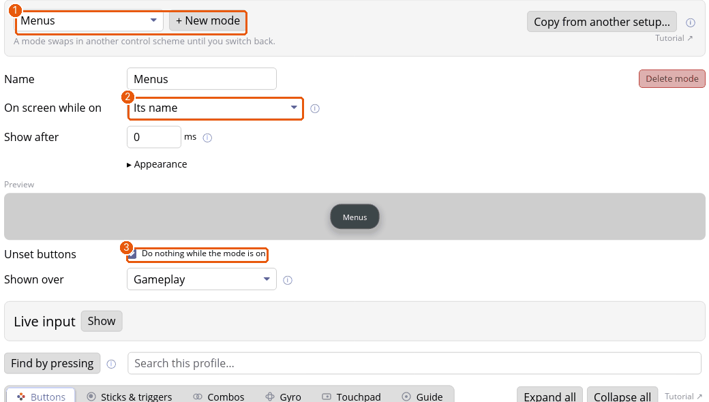

# Tutorial: a Driving mode you switch to and stay in

A mode is another control scheme inside a game that you switch to and stay in. You'll make a **Driving** mode where the sticks and triggers steer and accelerate, and a button that switches in and out of it.

## 1. Make the mode and the switch

1. On the profile's **Buttons** tab, click **Y (North)**.
2. Choose **Switch mode…**, then **+ New mode** in the picker. A mode is made, and Y switches to it.
3. Open the setup's **Modes** tab and rename the mode to *Driving*.

## 2. Set the mode's controls

1. The picker (1) chooses which mode to edit; **+ New mode** adds one.
2. **On screen while on** (2): the mode's name, nothing, an info overlay, or a generated sheet of its bindings.
3. **Unset buttons: Do nothing while the mode is on** (3) turns off every button the mode doesn't set, except those that switch modes or hold layers, so there's always a way back.

Now give the mode its own controls on its tabs. A setting the mode doesn't change reads **Same as** the profile; **Override** gives the mode its own value.

1. On **Sticks & triggers**, override what the game should read differently. If the profile maps the left stick to keys, say, override it to a **Gamepad stick** for analog steering.
2. On the **Buttons** tab, override what you need, such as A for handbrake.

## 3. Add the way back

Inside the Driving mode, give **Y (North)** the same **Switch mode…** *Driving*. Pressing it while Driving is on goes back to the default mode. (To go straight to another mode, give it a **Switch mode…** for that one.)

## 4. Save and try it

Press **Save & apply**. Tap Y: the mode's name shows on screen and the controls change. Tap Y again to leave.

## Good to know

- Only one mode is on at a time. With none on, you're in the *default mode*: the profile itself.
- A mode stays on when a menu or the keyboard opens, and when the profile changes within the game. Switching to another game goes back to the default.
- For several modes, put **Switch mode…** items in a list or carousel [menu](tutorial-menus.md).
- Mode or layer? A mode is for a change of context (driving, flying, a minigame). A [layer](tutorial-layers.md) is for extra controls while you hold a button.

## Where next

- [Modes](modes.md) for the reference.
- The [Guide overlay](tutorial-guide.md) shows what each mode does.
