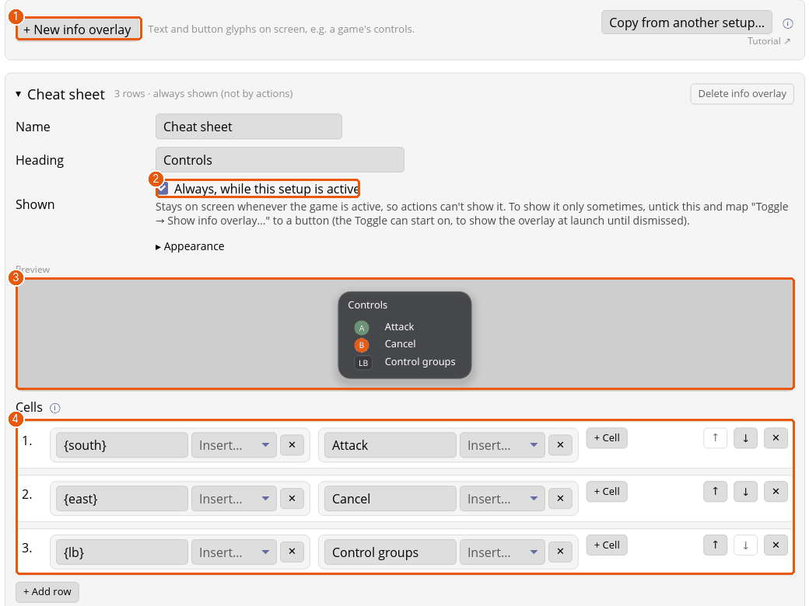
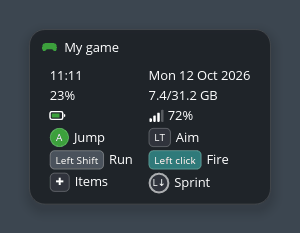
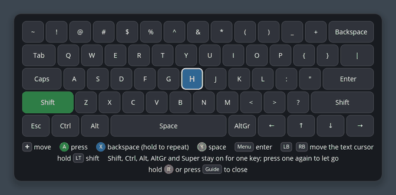

# Tutorial: a cheat sheet on screen, and the on-screen keyboard

Padwight can draw on top of a game, even a fullscreen one, without taking keyboard focus. Your key presses still go to the game underneath. You'll make an info overlay (a cheat sheet with button pictures) and then use the on-screen keyboard.

Overlays need a desktop that supports them: KDE Plasma, Sway, Hyprland or labwc. GNOME doesn't. See [On-screen keyboard, numpad and overlays](overlays.md).

## 1. Make an info overlay

1. Open the setup's **Info overlays** tab and press **+ New info overlay** (1). The new overlay opens.
2. Give it a **Name** and a **Heading**, which is the title drawn above the grid.
3. **Shown** (2) decides when it's on screen. Tick **Always, while this setup is active** for a permanent cheat sheet. Untick it to show the overlay only sometimes: map **Toggle on / off…** with **Show info overlay…** inside it to a button, and the Toggle can start on, to show the overlay at launch until dismissed.
4. The **Preview** (3) shows the result as you type.
5. **Cells** (4) is the grid. Each row is a list of cells, and cells line up in columns. A cell is text, or a `{token}`: `{south}` draws the A button's picture as your controller labels it (Xbox, PlayStation or Nintendo glyphs, to match the controller in use), and the **Insert…** dropdown lists the others, such as the time, CPU load and the current mode. Put a button picture in the first cell and what it does in the second.
6. **+ Cell** adds a cell to a row and **+ Add row** adds a row.

Under **Appearance**, each overlay can have its own position, size and colors. For a whole setup's look, use the Details tab.

## 2. Show a log of your presses

The **Log overlays** tab makes a small list of the buttons you pressed lately and what each did. It's useful while you check a mapping. It's made the same way as an info overlay, and shown with **Show log overlay…**.

## 3. The on-screen keyboard

Open the keyboard with a button set to **On-screen keyboard**, from the Overview page, or with Guide + X. Then:

- **D-pad or Left Stick** moves between keys. **A** presses the selected key (hold A to hold the key down).
- **Shift, Ctrl, Alt, AltGr and Super** stay on for the next key only, so you can type a shortcut like Ctrl + C.
- **X** is Backspace, **Y** is Space, **Start** is Enter, **LB** and **RB** move the text cursor, and holding **LT** holds Shift.
- **Hold B**, or press **Guide**, closes it.

On the **App settings** page you can choose **Basic** keys (what typing into a game needs) or **Full** ones. The **numpad** (Guide + Y) is a small pad of digits for codes. **Media controls** (Guide + LB) drive the music or video player that's running.

## 4. Make overlays fit the game

On the setup's **Details** tab, a setup can have its own font, motion, sounds and colors for every overlay, so a fantasy game's menus can glow gold while a shooter's stay flat and square. If overlays make your computer stutter, the **Performance** card on **App settings** turns decorations, motion and sounds off everywhere.

## Where next

- [On-screen keyboard, numpad and overlays](overlays.md) for the reference.
- A layer or mode can show an info overlay while it's on: see [layers](tutorial-layers.md).
