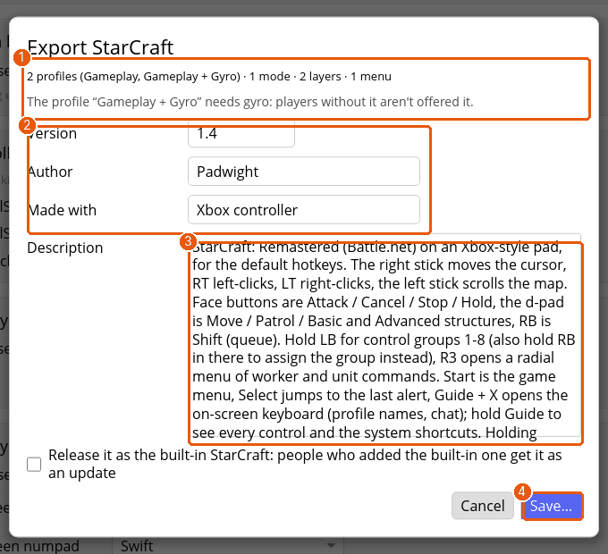

# Tutorial: share a setup as a pack, and use someone else's

A setup can be shared as a pack, a `.padpack` file that holds its profiles, macros, menus, layers, overlays, rules and description. You'll export a setup, then import one.

## 1. Export

Open the setup's **Details** tab and press **Export…** in the **Pack** card.

1. The summary (1) lists what the pack holds, which controller features its profiles need (gyro, a touchpad), and any broken references, such as a button pointing at a missing macro. Fix those before you save.
2. **Version**, **Author** and **Made with** (2). Versions compare number by number, so `1.10` is newer than `1.9`. A higher version marks installed copies *update*.
3. The **Description** (3) is what people read before adding the pack: the layout, and the pad it's made for.
4. Press **Save…** (4) and choose where to put the `.padpack`.

Then press **Save & apply** to keep the export details in the setup.

## 2. Import

1. Click **+ Add setup** and **Import a file…**, then pick the pack.
2. A **preview** shows what's in the pack, what it needs that your controller lacks, and any clash with your setups' names, with a choice to rename or replace.
3. Nothing changes until you confirm and press **Save & apply**.

To test an export, import it back with **Rename**, then delete the copy.

## 3. The library

**+ Add setup** also lists the setups that come with Padwight, installed and running games first. When a game the library knows comes to the front, a note says so: tap Guide to see its profiles and add it.

When a newer version of a setup you added is available, the sidebar marks it *update*. Before updating, Padwight lists the changes you've made, because an update replaces them.

> **Tip:** a pack made with a newer Padwight can't be imported. Update Padwight first.

## Where next

- [Sharing setups: packs and the library](sharing.md) for the reference.
- [Making a pack, step by step](tutorial-deus-ex.md) builds a whole pack, and the [pack format](https://github.com/marcinkoza0922/padwight/blob/main/docs/pack-format.md) documents the file.
