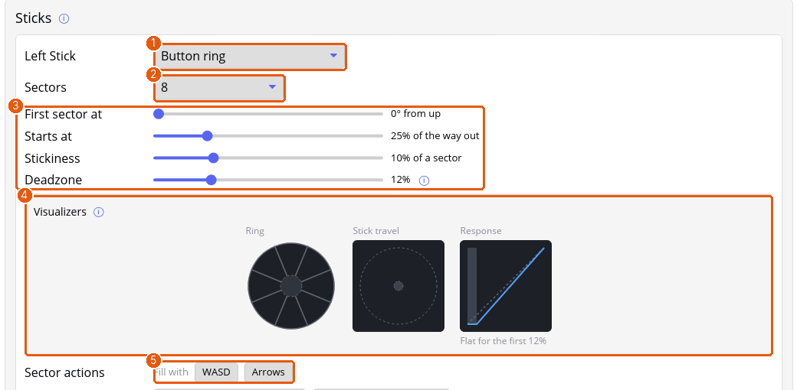
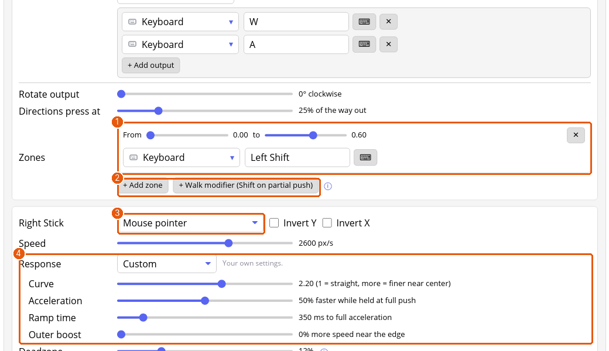

# Tutorial: sticks as keys, mouse and walk zones

You'll turn the left stick into WASD movement with a walk zone, and the right stick into mouse-look. Open a profile's **Sticks & triggers** tab.

## 1. Left stick: a ring of keys

Each stick has a box of its own. Its first dropdown is what the stick does: pass through as a gamepad stick, move the **Mouse pointer**, **Scroll wheel**, **Flick stick**, or a **Button ring**.

1. Choose **Button ring** in the left stick's dropdown (1).
2. **Sectors** (2) splits the stick into 4, 8 or 12 pieces. Eight gives diagonals, which is what walking wants.
3. Under **Sector actions**, press **WASD** next to *Fill with* (5). Every sector gets the key or keys for its direction: W for up, W and D together for up-right, and so on. **Arrows** fills in the arrow keys instead.
4. The sliders (3) shape the ring. **Deadzone** is how far the stick must move before it counts: raise it if the stick drifts at rest. **Starts at** is how far out a sector begins. **Stickiness** keeps a sector held a little past its edge, so a wobble doesn't flick between neighbours.
5. The pictures under **Visualizers** (4) show the ring, the stick's travel and its response. They follow your stick when the daemon is running and this profile is active.

## 2. Walk and run with a zone

A zone adds an action while the stick is pushed part of the way.

1. At the bottom of the left stick's box, press **+ Add zone** (or **+ Walk modifier (Shift on partial push)**, which makes the zone below for you) (2).
2. Set the zone **From 0.00 to 0.60** and give it the action **Keys** and **Left Shift** (1).

While the stick is in the first 60% of its travel, Shift is held. In most games that means a light push walks and a full push runs.

## 3. Right stick: mouse-look

1. Choose **Mouse pointer** in the right stick's dropdown (3).
2. **Speed** is the pointer's speed at a full push, in pixels a second. Start near 1600 and adjust.
3. **Response** (4) shapes how the push turns into speed. Pick a preset, or **Custom** and adjust:
   - **Curve** above 1 gives fine control near the middle and full speed at the edge.
   - **Acceleration** and **Ramp time** speed the turn up while you hold the stick at full push, as console shooters do.
   - **Outer boost** adds speed near the edge.
4. **Deadzone** hides drift. **Invert Y** flips up and down.
5. Under **Advanced**, **Vertical speed** sets up and down as a share of the horizontal speed.

## 4. Save and try it

Press **Save & apply** and walk around. The **Pointer speed** and **Speed by direction** pictures under the right stick show how the pointer will move; hover the graph to read the speed at any push.

## 5. Fit the deadzone to the stick and the game

Each stick's settings run in a fixed order, and tuning them in that order saves going back:

1. **Deadzone**: with the controller untouched, raise it until the *Stick travel* picture's dot stays inside the shaded middle, then stop. A bigger one than needed only makes small pushes do nothing.
2. **Deadzone shape**: leave it on **Circle**. Try **Cross** on a ring for movement that should stay clean along straight lines.
3. **Anti-deadzone**: for a stick set to **Gamepad stick**, in a game that ignores small pushes. Raise it until the lightest push moves the game, then back off a step. The *Response* picture shows the step it adds. Mouse and ring modes don't need it.
4. **Anti-deadzone hold**: only if you want a flat patch just past the deadzone, such as a steady sneak.
5. **Invert X** and **Rotate output** at the bottom: for a game that expects a flipped or turned stick.

Change one setting, press **Save & apply**, and test it in the game before the next.

## Triggers

Triggers are on this tab too. A trigger can pass its pull on as an analog value, or work as a button that fires past a **threshold**. Zones work on triggers: a half pull and a full pull can do different things. Controllers whose triggers are only on or off don't have zones.

## Where next

- [Sticks and triggers](sticks.md) for flick stick and scrolling.
- The game setup guidelines for shooters (in the repository's `docs/development`) list the curve and deadzone values packs start from.
- [Gyro](tutorial-gyro.md) to add motion aiming on top of the right stick.
