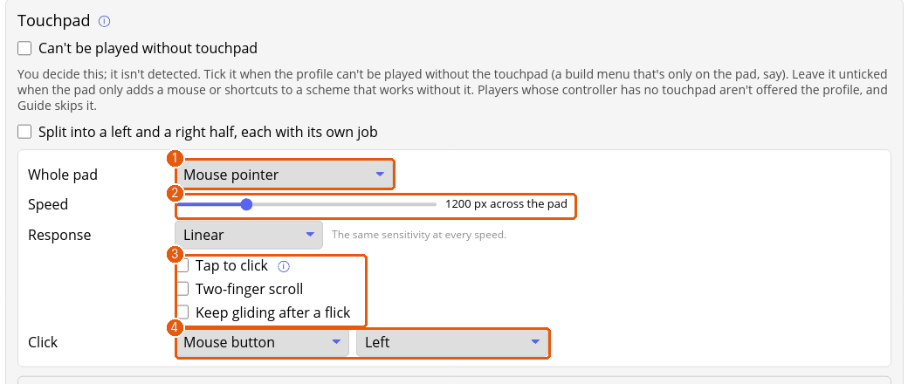

# Tutorial: use the touchpad as a mouse, a stick or a menu

DualShock 4 and DualSense controllers have a touchpad that you can also press down like a big button. You'll turn it into a trackpad, then split it so each half does a different job. Open a profile's **Touchpad** tab.

**You'll need** a controller with a touchpad. With none to hand, `padwight debug` has a touchpad you can drag on with the mouse; see the development docs.

## 1. A trackpad

1. Choose **Mouse pointer** for the whole pad (1). **Speed** (2) is how far the pointer moves when your finger crosses the whole pad.
2. Tick the extras (3):
   - **Tap to click** makes a quick tap run the click, so you needn't press the pad down.
   - **Two-finger scroll** scrolls when two fingers move together.
   - **Keep gliding after a flick** keeps the pointer sliding and slowing to a stop after you flick and lift, like a trackball. Touching the pad stops it.
3. **Click** (4) is what pressing the pad down does. It takes any action, like a button.

## 2. Split it in two

Tick **Split into a left and a right half, each with its own job**. Now each half has a box of its own and its own click. A finger belongs to the half it landed on even if it slides over the middle, so you can use both thumbs at once.

A common layout: the left half as a **Gamepad stick** for moving (tick **Center where the finger lands**, so you needn't aim for the middle), and the right half as a **Mouse pointer**.

## 3. A menu on the pad

Choose **Menu zones** to divide the pad into the items of one of your [menus](tutorial-menus.md). While a finger is on the pad, the menu shows on screen with the item under your finger picked. **Choose by** sets how you run it: press the pad down, or lift your finger. Untick **Show the menu while a finger is on the pad** once you know the zones by heart.

## 4. Swipes

**Swipes** runs an action for a quick stroke up, down, left or right. **Swipe length** is how far the stroke must go.

## 5. Check it

The **Visualizers** panel under the boxes draws the pad. It shows each half's job and the menu's items, and fingers on your pad show up on it.

Tick **Can't be played without touchpad** only if the profile depends on the pad. Players without one then aren't offered the profile.

## Where next

- [Touchpad](touchpad.md) for every mode.
- [Layers](tutorial-layers.md) can turn the pad into a menu while you hold a button.
